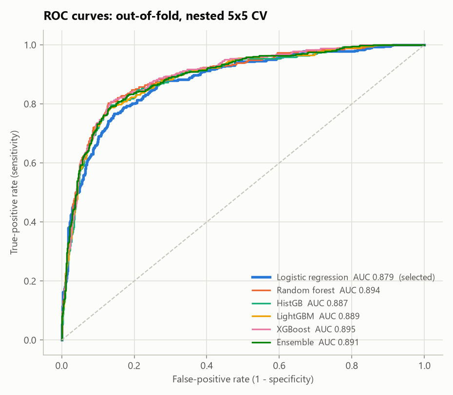
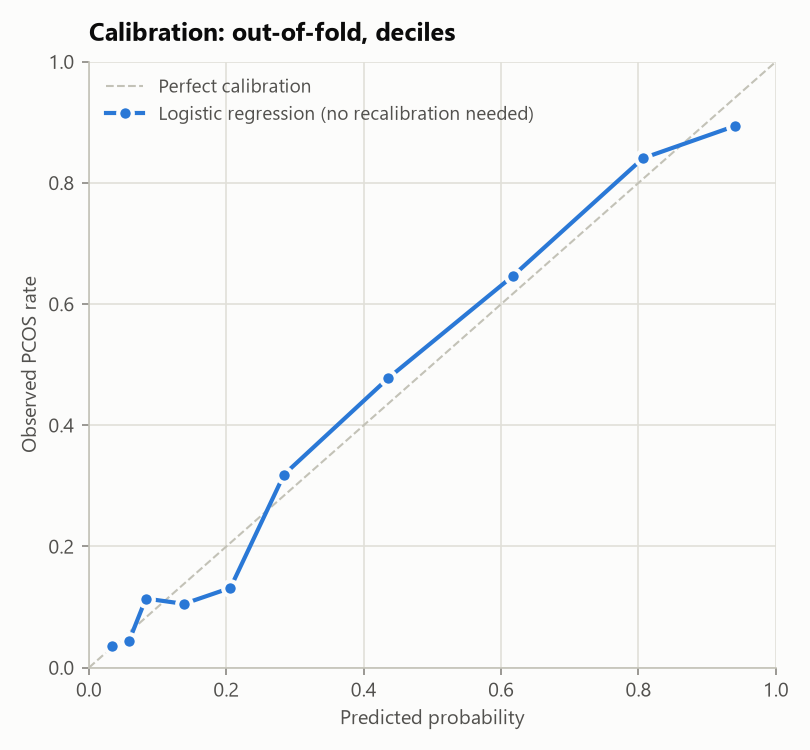
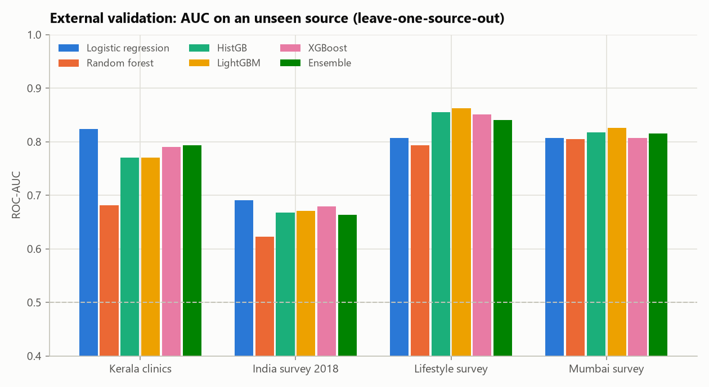
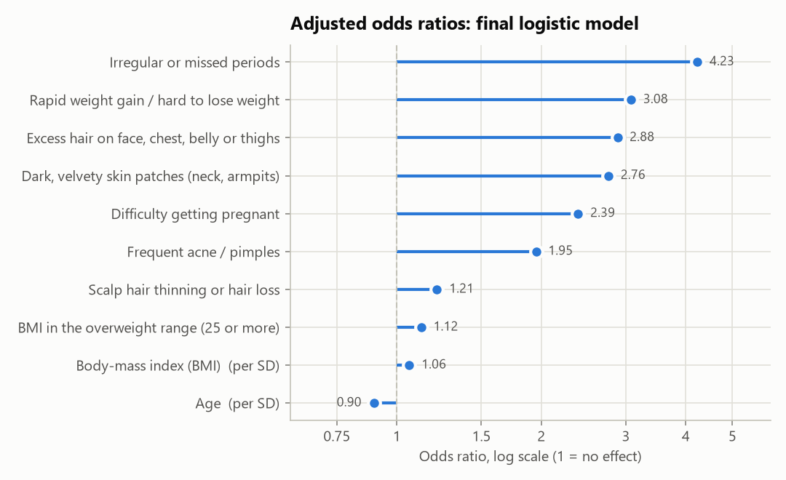
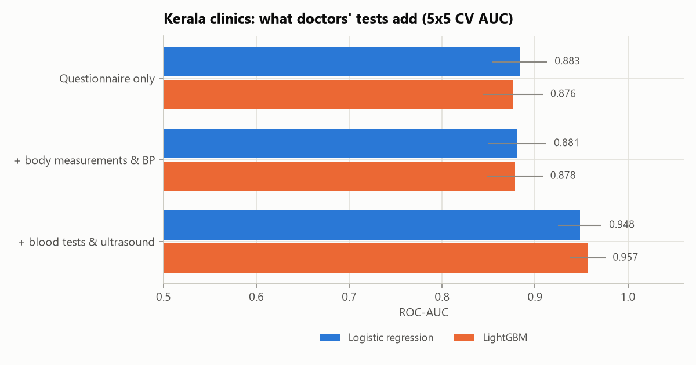

# Model card: PCOS questionnaire screening model

*Auto-generated by `python -m pcos_screen.train` on 2026-10-15T12:55:57+00:00 (v1.0.0).*

## Intended use
Educational **screening** of PCOS/PCOD risk from self-reported answers, for teenage girls and adult women. It is **not a diagnostic device**. A high score means "talk to a doctor", and a low score does not rule PCOS out. In adolescents, and anyone within 8 years of their first period, the 2023 guideline rule engine leads the result and the ML score is supporting information.

## Data
1135 labelled people from 4 independent sources (overall PCOS prevalence 35.9%).

| Source | n | PCOS prevalence |
|---|---|---|
| Kerala clinics | 541 | 32.7% |
| India survey 2018 | 161 | 83.2% |
| Lifestyle survey | 172 | 22.1% |
| Mumbai survey | 261 | 22.6% |

**Model features (10):** `age`, `bmi`, `overweight`, `irregular_cycle`, `weight_gain`, `excess_hair`, `acne`, `hair_loss`, `skin_darkening`, `conception_difficulty`

## Selected model
**Logistic regression**, calibration: **none**. Selection rule: best LOSO AUC 0.782 (lightgbm); chose 'logreg' (0.782), the simplest model within 0.010.

| Metric (out-of-fold, calibrated) | Value |
|---|---|
| ROC-AUC (95% CI) | 0.879 (0.857-0.898) |
| PR-AUC | 0.816 |
| Brier score | 0.130 |
| Calibration slope / intercept | 1.02 / 0.01 |
| Expected calibration error | 0.034 |
| Mean leave-one-source-out AUC | 0.782 |

## Risk bands
* **Low**: p < 0.198. Sensitivity at this cut-off is 90.2%, so only about 10% of PCOS cases score below it.
* **Moderate**: 0.198 <= p < 0.320.
* **High**: p >= 0.320. Specificity at this cut-off is 80.1% (sensitivity 80.1%).

## Model comparison
| Model | CV AUC (mean +/- SD over folds) | Pooled OOF AUC | Brier | LOSO mean AUC | LOSO Kerala clinics | LOSO India survey 2018 | LOSO Lifestyle survey | LOSO Mumbai survey |
|---|---|---|---|---|---|---|---|---|
| Logistic regression **(selected)** | 0.879 +/- 0.020 | 0.879 | 0.130 | 0.782 | 0.824 | 0.691 | 0.807 | 0.807 |
| Random forest | 0.893 +/- 0.017 | 0.894 | 0.122 | 0.726 | 0.681 | 0.623 | 0.794 | 0.805 |
| HistGB | 0.886 +/- 0.018 | 0.887 | 0.124 | 0.777 | 0.770 | 0.667 | 0.855 | 0.817 |
| LightGBM | 0.888 +/- 0.017 | 0.889 | 0.124 | 0.782 | 0.770 | 0.671 | 0.862 | 0.826 |
| XGBoost | 0.895 +/- 0.016 | 0.895 | 0.120 | 0.782 | 0.791 | 0.679 | 0.851 | 0.807 |
| Ensemble | 0.892 +/- 0.017 | 0.891 | 0.123 | 0.778 | 0.794 | 0.664 | 0.840 | 0.816 |

Paired bootstrap of the AUC difference (selected minus other):

| Other model | AUC diff | 95% CI | p |
|---|---|---|---|
| Random forest | -0.015 | -0.026 to -0.006 | 0.004 |
| HistGB | -0.009 | -0.018 to +0.000 | 0.052 |
| LightGBM | -0.010 | -0.018 to -0.003 | 0.006 |
| XGBoost | -0.017 | -0.026 to -0.008 | 0.000 |
| Ensemble | -0.013 | -0.019 to -0.007 | 0.000 |

## Adjusted odds ratios (final model)

| Answer | Odds ratio | Unit |
|---|---|---|
| Irregular or missed periods | 4.23 | present vs absent |
| Rapid weight gain / hard to lose weight | 3.08 | present vs absent |
| Excess hair on face, chest, belly or thighs | 2.88 | present vs absent |
| Dark, velvety skin patches (neck, armpits) | 2.76 | present vs absent |
| Difficulty getting pregnant | 2.39 | present vs absent |
| Frequent acne / pimples | 1.95 | present vs absent |
| Scalp hair thinning or hair loss | 1.21 | present vs absent |
| BMI in the overweight range (25 or more) | 1.12 | present vs absent |
| Body-mass index (BMI) | 1.06 | per 1 SD (3.4 kg/m2) |
| Age | 0.90 | per 1 SD (7.9 years) |

## Feature-set ablation (fixed hyper-parameters, mean LOSO AUC)

| Feature set | n | Logistic | LightGBM |
|---|---|---|---|
| all 14 questionnaire features | 14 | 0.761 | 0.721 |
| without lifestyle (fast food, exercise) | 12 | 0.774 | 0.745 |
| without lifestyle and wellbeing | 10 | 0.783 | 0.754 |
| selected model features | 10 | 0.783 | 0.754 |

## Clinical ceiling (Kerala cohort only)

| Inputs | n features | Model | CV AUC |
|---|---|---|---|
| questionnaire | 11 | Logistic regression | 0.883 +/- 0.030 |
| questionnaire | 11 | LightGBM | 0.876 +/- 0.032 |
| questionnaire+anthropometry | 19 | Logistic regression | 0.881 +/- 0.032 |
| questionnaire+anthropometry | 19 | LightGBM | 0.878 +/- 0.030 |
| questionnaire+anthropometry+labs+ultrasound | 35 | Logistic regression | 0.948 +/- 0.023 |
| questionnaire+anthropometry+labs+ultrasound | 35 | LightGBM | 0.957 +/- 0.019 |

Adding blood tests and ultrasound raises accuracy a lot. That is why a high questionnaire score should lead to a clinical work-up, not a self-diagnosis.

## Limitations
* Survey labels are self-reported diagnoses. Women already diagnosed may notice and report symptoms more often (awareness bias).
* Every source is from India. Performance in other populations is unknown. Leave-one-source-out validation is the best available proxy.
* Few training records are from girls under 18. For them, the guideline rule engine is primary.
* Hirsutism is self-assessed. Clinicians use the modified Ferriman-Gallwey score, which this questionnaire only approximates.
* This model has not been prospectively validated and is not a medical device.

## Figures

